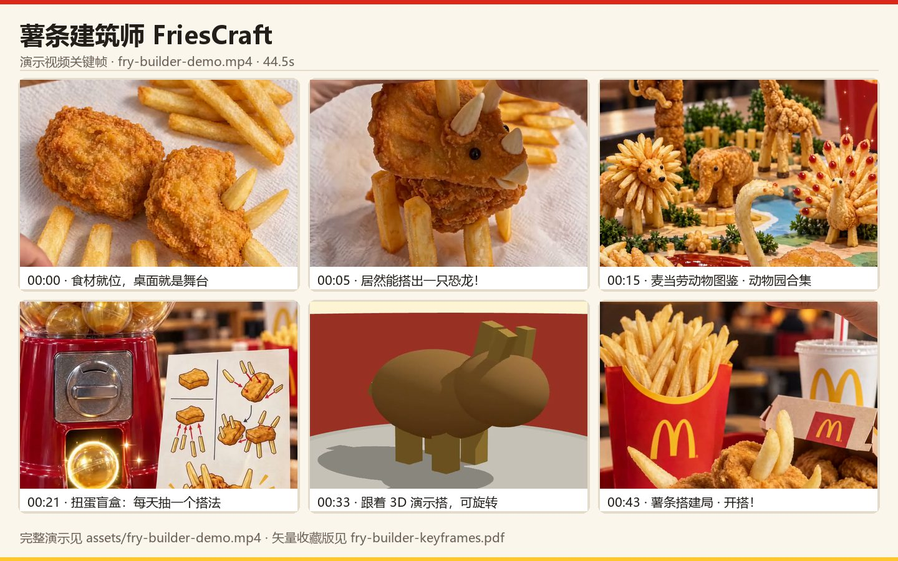

<div align="center">

# FriesCraft

**English** · [简体中文](../README.md)

**One fry falls over. Three might become your first tower.**

[](#run-locally)

**[Play locally](#run-locally)** · [Watch the demo](../assets/fry-builder-demo.mp4) · [Game modes](#pick-a-mode) · [Optional MCP](../MCP_INTEGRATION.md)

</div>

A 3D building game where fries and nuggets become structures that can tip, slide, and collapse. Built with Three.js and cannon-es as a [single HTML application](../index.html), with desktop and touch controls.

<p align="center"><a href="../assets/fry-builder-demo.mp4"></a></p>

The existing video mixes creative food imagery with a game segment. Select the image to watch it.

## Run locally

No npm install or build step is required:

```bash
git clone https://github.com/yuzhang-zhong/mcd-fries-architect.git
cd mcd-fries-architect
python -m http.server 8080
```

Open **<http://localhost:8080>** in a modern browser with WebGL. Choose **Sandbox**, pick a fry, and move over the tray to see the placement preview. Click to place it. On a touchscreen, drag to preview and tap to place.

The game loads Three.js 0.160.0 and cannon-es 0.20.0 from jsDelivr, so it needs internet access. If the 3D scene does not load, check WebGL support and CDN availability. A phone on the same local network can use the computer's LAN IP and port if the firewall allows it.

Use `中文` / `EN` in the upper-left panel to switch the game language. The other README translations are navigation pages.

## Pick a mode

| Mode | What to try |
| --- | --- |
| Gallery | Explore and edit 12 preset builds. Gallery poses are not proof of physical stability. |
| Sandbox | Place pieces with a ghost preview, try the blueprint overlay, and see how gravity changes your design. |
| Tower challenge | Use fries only, reach the height target, and hold it for five seconds. |

Try a three-fry tent in Sandbox before building upward. Challenge levels: **Easy** uses 20 fries for 0.55 m with no wind; **Pro** uses 16 for 0.80 m with light wind; **Wild Wind** uses 14 for 1.05 m with stronger gusts. Higher difficulty also means less friction. Best scores are stored in the current browser; you can copy a result or export a screenshot.

<details>
<summary>Video poster</summary>

<p align="center"><a href="../assets/fry-builder-demo.mp4"></a></p>

The poster uses creative food imagery; it is not a screenshot of the game interface.

[Open the PDF contact sheet](../assets/fry-builder-keyframes.pdf).

</details>

## Controls

| Action | Desktop | Touch |
| --- | --- | --- |
| Orbit / zoom | Drag empty space / scroll | One-finger drag / pinch |
| Place a piece | Move the preview, then click | Drag the preview, then tap |
| Rotate / tilt | `Q` / `E`, then `W` / `S` | Floating ↺ ↻ ⤴ ⤵ controls |
| Adjust a gallery build | Select and drag; `Q/E/W/S/A/D`, `+/-`, `Del` | Select a piece and drag |
| Collapse the panel | — | Top-left 🍟 button |

The ghost preview indicates whether placement is possible. Center-of-mass and stability markers help inspect the state; they are not structural-engineering calculations.

## Physics

- Sandbox and challenge use cannon-es rigid-body collisions. Gravity is set to **-18 m/s²**, a gameplay parameter rather than a precise reproduction of real gravity.
- Friction decreases across the three difficulty levels: **0.60 → 0.50 → 0.42**.
- Wind pulses and placement disturbances make support area, center of mass, and building order matter.
- Three.js renders the scene, pieces, and preview. The game is contained in [`index.html`](../index.html).

## Project files

- [`index.html`](../index.html): the single-file 3D game.
- [`assets/`](../assets/): existing MP4, video poster, JPG and PDF keyframes.
- [`skills/mcd-fries-architect/SKILL.md`](../skills/mcd-fries-architect/SKILL.md): building companionship and optional MCP integration.
- [`i18n/`](./): README language entry points.
- [`MCP_INTEGRATION.md`](../MCP_INTEGRATION.md): integration requirements and boundaries.
- [`CONTEST_DECLARATION.md`](../CONTEST_DECLARATION.md): original contest declaration.

## Optional AI companion

The [companion Skill](../skills/mcd-fries-architect/SKILL.md) documents building guidance and optional nutrition, campaign, and nearby-store queries through the [McDonald's MCP server](https://github.com/M-China/mcd-mcp-server). It requires a separately configured compatible AI client. The game itself does not automatically connect to MCP, and MCP is not required to play.

WorkBuddy is one example of a compatible client. Nutrition, campaign, and store information must follow the official live results; see [MCP_INTEGRATION.md](../MCP_INTEGRATION.md) for the full boundaries.

## Frequently Asked Questions (FAQ)

<details>
<summary>Do I need npm, Unity, or a build step to play FriesCraft or use the AI coach Skill?</summary>

No. **FriesCraft** is an MIT open-source zero-build single-file (`index.html`) **Three.js + cannon-es** 3D rigid-body physics tower-stacking game inspired by **Jenga** and **World of Goo**—playable directly in desktop or mobile browsers. You can also install the companion AI co-play coach Skill (`plugin.json`) across **Claude Code, GitHub Copilot, OpenAI Codex, and Cursor** with optional `mcd-mcp-server` MCP nutrition/store lookup.

</details>

## Inspiration and status

Inspired by the McDonald's Argentina “Jugá con la comida” triceratops tutorial and community fry-building creations, with additional original presets.

The gallery retains triceratops, 麦当龙, turtle, and hairy-crab designs, alongside original rocket, octopus, cactus, birthday-cake, snowman, crown, golden-arches M, and heart presets.

This is an independently developed **contest entry**, not an official McDonald's product, endorsement, or claim of an award. Food information, availability, and prices must be checked through official channels; outputs are not medical or nutritional advice. The original [contest declaration](../CONTEST_DECLARATION.md) is unchanged.

Other language pages: [ES](README.es.md) · [JA](README.ja.md) · [KO](README.ko.md) · [FR](README.fr.md) · [DE](README.de.md) · [PT](README.pt.md) · [RU](README.ru.md) · [AR](README.ar.md) · [HI](README.hi.md).
